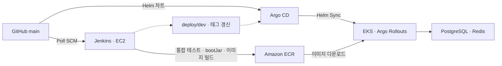

# QUANTFLOW Backend

QUANTFLOW 안드로이드 앱을 위한 Spring Boot API 서버입니다. 네이버 뉴스와 토스증권의 국내 주식 데이터를 바탕으로 종목을 추천하고, 사용자가 연결한 토스증권 계좌의 보유 종목·매수 가능 금액·주문 상태를 제공합니다.

## 주요 기능

- **로그인** — Android에서 발급받은 Google ID 토큰을 검증하고 QUANTFLOW Access Token과 Refresh Token을 발급합니다.
- **오늘의 종목 추천** — 직전 거래일의 거래량·외국인·기관 순매수 랭킹과 네이버 뉴스를 이용해 코스피·코스닥 종목을 추천하고 결과를 저장합니다.
- **관심 카테고리 추천** — 사용자가 선택한 카테고리의 종목을 대상으로 추천합니다. 관심 카테고리는 선택 사항입니다.
- **토스증권 연동** — 계좌 검증·연결, 보유 종목 조회, 매수 가능 금액·현재가 조회를 지원합니다.
- **자동매수** — 저장된 오늘의 공통 추천과 계좌별 설정을 바탕으로 주문을 처리합니다. 개발 EKS에서는 시장 데이터 수집과 추천 스케줄을 사용하며 자동매수 스케줄은 비활성 상태입니다.

## 기술 스택

| 영역 | 기술 |
| --- | --- |
| 백엔드 | Java 17, Spring Boot 4.1.2, Spring Security, Gradle Wrapper |
| 데이터 | PostgreSQL 16, Flyway, Redis 7.4 |
| 외부 연동 | Google OIDC, 토스증권 Open API, 네이버 뉴스 검색 API, OpenAI |
| API 문서 | Springdoc OpenAPI, Swagger UI |
| 빌드·배포 | Jenkins, Docker, Amazon ECR, Amazon EKS, Helm, Argo CD, Argo Rollouts |

## 로컬에서 실행

Java 17과 Docker가 필요합니다. 통합 테스트를 실행하려면 Python 3도 설치합니다. 아래 명령은 저장소 루트에서 실행합니다.

### PostgreSQL과 Redis 준비

기존 개발용 PostgreSQL과 Redis가 있으면 해당 접속 정보를 사용합니다. Docker로 새로 시작하는 경우 아래 명령으로 `quantflow_db`와 Redis를 준비합니다.

```bash
docker run -d --name quantflow-local-postgres \
  -p 127.0.0.1:5432:5432 \
  -e POSTGRES_DB=quantflow_db \
  -e POSTGRES_PASSWORD=local-dev-password \
  -v quantflow-local-postgres:/var/lib/postgresql/data \
  postgres:16

docker run -d --name quantflow-local-redis \
  -p 127.0.0.1:6379:6379 redis:7.4
```

### 환경변수와 실행

저장소 루트에 `.env` 파일을 만들고 `KEY=value` 형식으로 설정합니다. `JWT_SECRET_BASE64`와 `BROKER_ENCRYPTION_KEY_BASE64`에는 각각 `openssl rand -base64 32`로 생성한 별도의 값을 사용합니다.

```dotenv
DB_URL=jdbc:postgresql://localhost:5432/quantflow_db
DB_USERNAME=postgres
DB_PASSWORD=local-dev-password
REDIS_HOST=localhost
REDIS_PORT=6379
REDIS_PASSWORD=
GOOGLE_WEB_CLIENT_ID=<Google 웹 클라이언트 ID>
JWT_SECRET_BASE64=<JWT 서명 키>
BROKER_ENCRYPTION_KEY_BASE64=<증권사 정보 암호화 키>
OPENAI_API_KEY=<OpenAI API 키>
OPENAI_MODEL=<사용할 모델>
NAVER_CLIENT_ID=<네이버 API Client ID>
NAVER_CLIENT_SECRET=<네이버 API Client Secret>
STOCK_SYNC_TOSS_CLIENT_ID=<토스 조회용 Client ID>
STOCK_SYNC_TOSS_CLIENT_SECRET=<토스 조회용 Client Secret>
```

`BROKER_ENCRYPTION_KEY_BASE64`는 계좌 연결에 필요합니다. `STOCK_SYNC_TOSS_CLIENT_*`는 종목·랭킹 수집과 일일 추천의 거래일 확인에 사용됩니다. 실제 키는 환경별 `.env` 또는 Kubernetes Secret으로 관리합니다. Flyway는 백엔드가 시작될 때 데이터베이스 스키마를 적용합니다.

```bash
./gradlew bootRun
```

Windows PowerShell에서는 `.\gradlew.bat bootRun`을 사용합니다. 실행 후 [헬스 체크](http://localhost:8080/actuator/health)와 [Swagger UI](http://localhost:8080/swagger-ui.html)를 열 수 있습니다.

### 통합 테스트

```bash
python3 scripts/test-toss-integration.py --no-daemon
```

스크립트는 임시 PostgreSQL과 Redis를 Docker에서 실행하고, 테스트용 환경변수와 가짜 토스 서버를 사용합니다. 실행이 끝나면 임시 컨테이너를 정리합니다. Windows에서는 `python3` 대신 `py -3`을 사용할 수 있습니다.

## 안드로이드 연동

Android에서 Google SDK로 받은 ID 토큰을 로그인 API에 전달합니다. 이후 인증이 필요한 API는 QUANTFLOW의 `accessToken`을 `Authorization: Bearer {accessToken}` 헤더로 보냅니다.

| 기능 | API |
| --- | --- |
| Google 로그인 | `POST /api/v1/auth/oauth2` |
| 세션 갱신 | `POST /api/v1/auth/reissue` |
| 내 정보 | `GET /api/v1/users/me` |
| 토스증권 계좌 검증·연결 | `POST /api/v1/broker-connections/toss/verify`, `POST /api/v1/broker-connections/toss` |
| 보유 종목 | `GET /api/v1/broker-connections/{connectionId}/holdings` |
| 오늘의 추천 | `GET /api/v1/analyses/recommendation/today` |
| 카테고리 목록 | `GET /api/v1/categories` |
| 카테고리별 추천 | `POST /api/v1/analyses/recommendation/category?categoryCode={code}` |

오늘의 추천 API는 저장된 결과를 반환합니다. 결과가 없으면 `404`를 반환하고, 추천을 보류한 결과는 `stock: null`과 사유를 반환할 수 있습니다. [Android 인증](docs/android-auth.md) · [카테고리 및 관심 설정](docs/category-recommendation.md)

## AWS 개발 배포



Jenkins는 서울 리전의 프라이빗 EC2에서 실행됩니다. Jenkins 런타임은 Java 21을 사용하고, 프로젝트는 Gradle의 Java 17 설정으로 빌드합니다. 점선은 별도로 연결하는 배포 태그 자동화입니다.

### 1. Jenkins에서 이미지 빌드

[Jenkinsfile](Jenkinsfile)을 읽는 Pipeline 작업을 만들고 `main` 브랜치를 지정합니다. Jenkins가 약 5분마다 Git 변경을 확인해 통합 테스트를 실행하고, JAR를 빌드한 뒤 [Dockerfile](Dockerfile)로 컨테이너 이미지를 만듭니다. Jenkins EC2의 IAM 역할로 ECR에 로그인해 `quantflow-backend:<빌드 번호>-<커밋 해시>` 태그를 푸시합니다.

### 2. EKS 설정과 배포

개발 환경은 EKS 클러스터 `quantflow-dev-eks`의 `quantflow-dev` 네임스페이스를 사용합니다. 클러스터에는 ECR 이미지를 읽을 수 있는 노드와 Argo CD·Argo Rollouts가 준비되어 있어야 합니다. PostgreSQL과 Redis는 백엔드 Pod에서 접근할 수 있는 주소를 사용합니다.

클러스터를 새로 준비할 때는 네임스페이스를 만들고, 앞서 정의한 환경변수를 EKS용 값으로 작성한 파일을 사용해 Secret을 생성합니다. Helm 차트의 `existingSecret`이 이 Secret을 참조합니다.

```bash
kubectl --context quantflow-dev-eks create namespace quantflow-dev
kubectl --context quantflow-dev-eks -n quantflow-dev \
  create secret generic quantflow-backend-secrets --from-env-file=/path/to/eks-dev.env
```

수동 배포에서는 [values-dev.yaml](deploy/helm/quantflow-backend/values-dev.yaml)의 `image.tag`에 ECR 태그를 지정하고 Git에 올립니다. Argo CD Application의 소스는 이 저장소의 `main`, 경로는 `deploy/helm/quantflow-backend`, Helm values 파일은 `values-dev.yaml`, 배포 대상은 `quantflow-dev`입니다. 차트를 확인하고 Argo CD에서 **Sync**를 실행합니다.

```bash
helm lint deploy/helm/quantflow-backend -f deploy/helm/quantflow-backend/values-dev.yaml
kubectl --context quantflow-dev-eks -n quantflow-dev get rollout,svc,pods
```

### 3. Blue/Green 전환

| 서비스 | 역할 |
| --- | --- |
| `quantflow-backend` | 현재 버전에 앱 트래픽을 전달하는 Active Service |
| `quantflow-backend-preview` | 새 이미지의 동작을 확인하는 Preview Service |

이미지 태그를 변경해 Sync하면 새 버전이 Preview에 올라옵니다. 아래 명령으로 연결을 열고, 브라우저에서 [Preview 헬스 체크](http://localhost:19081/actuator/health)를 확인합니다.

```bash
kubectl --context quantflow-dev-eks -n quantflow-dev \
  port-forward svc/quantflow-backend-preview 19081:8080
```

`autoPromotionEnabled: false`이므로 Preview가 `UP`인 것을 확인한 다음 **Promote**로 Active 트래픽을 전환합니다. Argo CD Application에는 Service의 `/spec/selector/rollouts-pod-template-hash`를 `ignoreDifferences`에 추가하고 `RespectIgnoreDifferences=true`를 설정해 Rollouts가 관리하는 Service 선택자를 보존합니다. [Blue/Green 동작](https://argo-rollouts.readthedocs.io/en/stable/features/bluegreen/) · [Argo CD 동기화 옵션](https://argo-cd.readthedocs.io/en/stable/user-guide/sync-options/#respect-ignore-differences-configs)

### 배포 태그 자동화

배포 태그 자동화 설정은 Jenkins의 ECR 푸시 이후, 빌드한 커밋의 차트와 태그를 담은 `image-dev.yaml`을 `deploy/dev`에 발행하는 흐름입니다. 적용하려면 Jenkins에 GitHub 쓰기 권한을 가진 `quantflow-gitops-write` 자격 증명을 등록합니다. 첫 발행으로 `deploy/dev`가 생성된 뒤 Argo CD가 그 브랜치의 `values-dev.yaml`과 `image-dev.yaml`을 읽도록 연결하고 Auto-Sync를 켭니다. Active로의 전환은 Promote 단계에서 승인합니다.

### 배포된 API 접속

개발 Service는 `ClusterIP`로 구성되어 있습니다. AWS 및 EKS 접근 권한이 설정된 컴퓨터에서 아래 명령을 실행합니다.

```bash
aws eks update-kubeconfig --region ap-northeast-2 --name quantflow-dev-eks --alias quantflow-dev-eks
kubectl --context quantflow-dev-eks -n quantflow-dev port-forward svc/quantflow-backend 19080:8080
```

포트 포워딩이 실행 중인 컴퓨터에서는 [Swagger UI](http://localhost:19080/swagger-ui.html)를 사용합니다. 같은 컴퓨터의 Android 에뮬레이터에서는 `http://10.0.2.2:19080/`을 개발용 `BASE_URL`로 설정합니다. 포트 포워딩 없이 접근하는 HTTPS 개발 주소는 ALB Ingress와 ACM 인증서를 연결하는 별도 배포 단계입니다.

## 예약 작업

앱이 닫혀 있거나 개발자 노트북이 종료되어도 EKS 백엔드 Pod가 실행 중이면 활성화된 작업은 예약 시각에 실행됩니다. 시간은 모두 한국 시간입니다.

| 작업 | 활성화 환경변수 | 기본 주기 |
| --- | --- | --- |
| 코스피·코스닥 종목 동기화 | `STOCK_SYNC_SCHEDULE_ENABLED` | 매일 오전 7시 |
| 거래량·투자자 랭킹 저장 | `RANKING_SNAPSHOT_SCHEDULE_ENABLED` | 평일 오후 9시 10분 |
| 일일 추천 생성 | `DAILY_RECOMMENDATION_SCHEDULE_ENABLED` | 평일 오전 7시 30분 |
| 자동매수 조건 확인 | `AUTO_BUY_SCHEDULE_ENABLED` | 오전 8시부터 오후 4시 59분까지 매분. 주문은 정규장과 계좌별 설정을 확인한 뒤 처리 |

코드의 기본값은 네 작업 모두 `false`입니다. EKS의 스케줄 플래그는 Secret에 저장하고 Pod 교체 시 반영합니다. Blue/Green 전환 중에는 Active와 Preview Pod가 같은 Secret을 읽으므로, 현재 개발 구성에서는 예약 시각과 배포 전환이 겹치면 양쪽에서 작업을 실행할 수 있습니다. [애플리케이션 설정](src/main/resources/application.yaml)

## 상세 문서

- [Android Google 로그인과 토큰 정책](docs/android-auth.md)
- [토스증권 계좌 연결](docs/toss-account-linking.md) · [보유 종목 조회](docs/toss-holdings.md) · [매수 가능 금액과 현재가](docs/toss-buying-power-price.md)
- [카테고리별 추천](docs/category-recommendation.md) · [자동매수 한도와 손익 상태](docs/daily-risk-state.md)
- [브라우저 테스트 UI](docs/test-ui.md)
